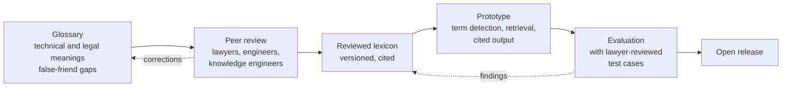
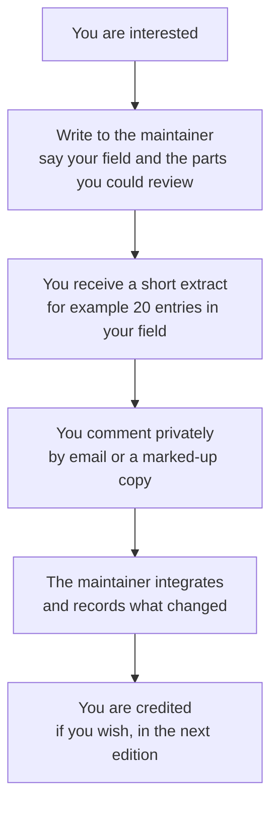

# BridgeLLM

**BridgeLLM is a proposed open project to build a bilingual AI system that understands both engineering language and legal language.** It is meant to detect domain false friends, and to map a product description to the EU and US rules that may apply (starting with the AI Act and GDPR). Every result cites its sources and ends with precise questions for a lawyer, so product teams can see regulatory exposure early, before they build the wrong thing.

> **Status: concept and groundwork.** The system itself does not exist yet. What exists is a first draft of a critical glossary book (392 entries, with its structure and method already worked out), which is the project's first knowledge base. It is a draft and has not been peer-reviewed. BridgeLLM gives legal information to help prepare a conversation with a lawyer. It is not legal advice.

## The problem

Engineers and regulators use the same words for different things. "Model", "provider", "training", "personal data", "deployer", "high-risk" and "transparency" each carry one meaning in a codebase and another in a statute. Teams find out late, when a design is already built, and the correction is expensive. Lawyers receive product descriptions full of terms they must first translate.

## What BridgeLLM would do

1. **Read** a product description in engineering language.
2. **Flag false friends**: terms whose technical and legal meanings differ, with both meanings shown side by side.
3. **Point to the rules** that may be engaged (AI Act, GDPR first; US federal and state rules later), each with a citation to the provision.
4. **Say what it does not know.** When the text is too thin to tell, it asks instead of guessing.
5. **Prepare the lawyer conversation**: a short list of precise questions to take to counsel.

It never states that a product is "compliant" or "non-compliant".

## How the work is organised

| Phase | What | State |
|---|---|---|
| 0. Lexicon | Critical glossary of AI terms: plain, technical and legal definitions, with the gap between them | **First draft of the book complete** (idea, structure, 392 entries); awaiting peer review |
| 1. Peer review | Lawyers and engineers check the definitions and the gaps | **Open call, see below** |
| 2. Prototype | Term detection, retrieval over the legal texts, cited output | Not started |
| 3. Evaluation | Lawyer-reviewed test cases; the system must abstain when unsure | Not started |

The planned architecture is in [docs/ARCHITECTURE.md](docs/ARCHITECTURE.md).

## Open call for peer review

We are looking for people to read and challenge the work. We are not asking anyone to join an online discussion or to use GitHub.

**Who we want to hear from**

- **Lawyers** (EU, French, US) to check the legal definitions and cited provisions.
- **NLP and LLM engineers** interested in term detection, retrieval and calibrated abstention.
- **Knowledge engineers** interested in the ontology of obligations and triggers.
- **Partners and sponsors** who want to close the gap between those who build products and those who regulate them.

**How to reach us:** write to the maintainer, Habbine Kim, via her [GitHub profile](https://github.com/habbine). Say who you are, your field, and what you could review. Reviewers decide how they are credited. Please do not send confidential client material.

## Licensing

- **Code** (`src/`, `tests/`, `.github/workflows/`): [MIT](LICENSE).
- **Content** (earlier assessments and the other material in this repository): [CC BY 4.0](LICENSE-CONTENT).
- **Draft definitions** ([`definitions/`](definitions/NOTICE.md)): all rights reserved, review draft, not published, and not covered by CC BY. Text and data mining is opted out under Directive (EU) 2019/790, art. 4(3).

"Open" here describes the method and the code. It does not mean the draft definitions are free to reuse. That decision will be made after peer review and stated here.

## Name

Another, unrelated software package on PyPI is called `bridgellm`. This project is not affiliated with it.

## What the glossary covers

Each entry gives three definitions (plain language, technical, legal under the EU AI Act), then the **gap** between them, a proposed fix, and French and Korean equivalents. Law covered: EU law first, with French and US comparative notes.

| Part | Subject | Entries |
|---|---|---|
| A | Foundational concepts | 16 |
| B | Learning paradigms, architectures and training methods | 27 |
| C | Model internals, inference and interaction | 17 |
| D | Data | 11 |
| E | Evaluation, performance and trustworthiness | 27 |
| F | Risk and regulatory classification | 18 |
| G | Value-chain actors and market concepts | 14 |
| H | Biometrics and synthetic content | 8 |
| I | Security threats and failure modes | 8 |
| J | Engineering patterns and operations | 12 |
| K | AI engineering and inference infrastructure | 234 |
| | **Total in the draft book** | **392** |

The repository currently holds the earlier working seed of this list; the full draft is being brought in step by step.

## Repository layout

- `docs/ARCHITECTURE.md`: planned system design
- `docs/glossary.csv`, `docs/taxonomy.md`: glossary entries and categories
- `data/terms/`: term notes and source material
- `src/`, `tests/`: build scripts and tests
- `assessment/`: the earlier term-assessment material, kept for reference
