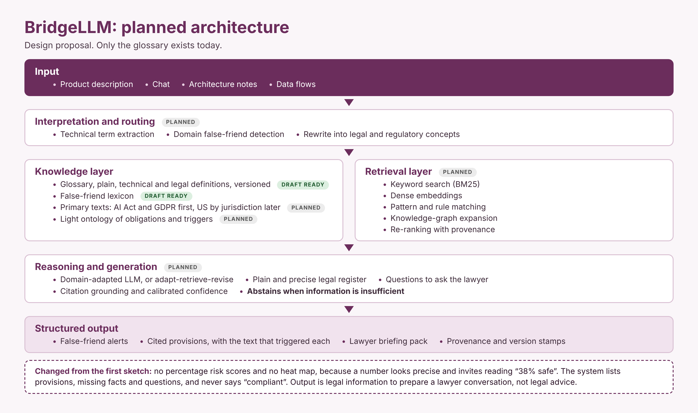

# BridgeLLM: planned architecture

Status: design proposal. Nothing below is built, except the glossary in the Knowledge layer.

## Changes from the first sketch, and why

1. **No percentage risk scores, no heat map.** A number such as "62% risk" looks precise, cannot be validated without a large lawyer-labelled data set, and invites the reading "38% safe". The output instead lists the provisions that may be engaged, with the text that triggered each, the missing facts, and the questions that would settle them.
2. **Abstention is a feature.** The reasoning step must be able to answer "not enough information", and that answer must be tested like any other.
3. **Retrieval before generation.** The model may only restate and connect retrieved, cited text. A provision that is not retrieved is not asserted. This also keeps the system auditable.
4. **A versioned legal corpus is its own component.** The AI Act was amended by Regulation (EU) 2026/1744, and US state law moves quickly. Every output carries the corpus version and date so a lawyer can see what it was based on.
5. **The glossary is the seed, not the product.** Its value to the system is the false-friend lexicon: for each term, the technical meaning, the legal meaning and the gap. Peer review of that lexicon comes first.
6. **Start narrow.** AI Act and GDPR first. US coverage is added by jurisdiction (federal, then selected states), not claimed as "US law" in general.
7. **Confidentiality by design.** Product descriptions can be sensitive. The design assumes a deployment where text is not sent to third-party model providers without the user's consent, and a local option.
8. **Lawyer in the loop.** The output is a briefing for counsel. It is not an opinion and says so on its face.

## Evaluation, in short

A small test set written and reviewed by lawyers: product descriptions with the provisions and false friends an expert would raise. Measured: whether expert-identified provisions are found, whether cited text actually supports each claim, and whether the system abstains when it should. Not measured: any claim of compliance.

## Open questions for reviewers

- Which false friends cause the most expensive misunderstandings in practice?
- Where is the line between a useful briefing and legal advice, in France and in the US?
- Which provisions beyond the AI Act and GDPR should come next (for example the Data Act, product liability, sectoral rules)?
